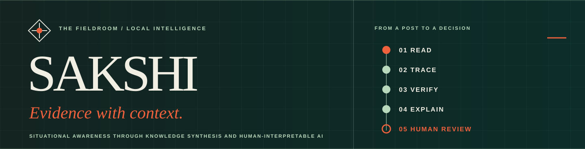
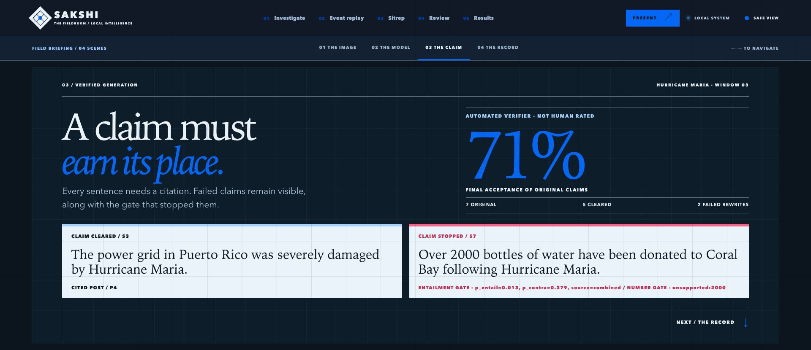

# SAKSHI

**A disaster post needs more than a label.** Its image may have appeared earlier; its caption may be misleading; a polished report sentence may lack support. SAKSHI brings the prediction, dated image history, model explanation, and cited report checks into one local fieldroom so a person can inspect the evidence.



*A saved Maria report window: one cited claim passed the automatic checks; an unsupported number claim was stopped.*

## Run the fieldroom

On the **prepared research laptop**, from this repository's root:

```bash
HF_HUB_OFFLINE=1 OMP_NUM_THREADS=2 MKL_NUM_THREADS=2 OPENBLAS_NUM_THREADS=2 \
  .venv/bin/sakshi-app --port 8501
```

Open **http://127.0.0.1:8501**. Keep the terminal open; press **Ctrl+C** to stop. The first live prediction loads cached weights and may take longer. Use `--port 8502` if the port is occupied. The fieldroom is the primary app; `.venv/bin/sakshi-streamlit` remains a functional fallback.

The prepared laptop has research data, trained checkpoints, and model caches that are intentionally absent from Git. A fresh clone needs the setup described [below](#reproduce-from-a-fresh-clone).

## What it does

| Step | What you see |
| :--- | :--- |
| **Classify** | Four decisions for an English crisis post: informativeness, humanitarian category, visible damage severity, and disaster type. Uncertain outputs can be withheld for review. |
| **Trace the image** | A visual match against a dated local archive. Event context and post time let the system distinguish an earlier indexed appearance from a same-event repost. |
| **Explain** | Word attribution and an image focus map for one selected prediction, computed on request. |
| **Build a report** | Saved event-window summaries with cited claims, five automatic checks, and rejected sentences still visible. |

**Investigate** handles a new text-and-image input. **Present** tells one saved historical case. **Event replay**, **Situation report**, **Review**, and **Results** open the underlying evidence. The classifier and image lookup can run live on the laptop; historical replays, report generation outputs, and research charts are prepared artifacts.

## Try a post

Open **Investigate**, enter English crisis-post text and/or upload a JPEG, PNG, or WebP image, then click **Analyze post**. The four model decisions, review state, and local image-history result appear together. Choose a decision under **What moved the decision** to compute its explanation. For an arbitrary upload, a missing archive match says nothing about whether the image appeared elsewhere online.

## What the evidence says

The classifier was evaluated over **three training seeds**. Scores below are mean macro-F1 on each task's **own official test set**, not one combined accuracy:

| Task | Test rows | Macro-F1, mean ± SD |
| :--- | ---: | ---: |
| Informativeness | 1,534 | **0.919 ± 0.001** |
| Humanitarian | 955 | **0.822 ± 0.027** |
| Disaster type | 3,213 | **0.856 ± 0.004** |
| Damage severity | 1,138 | **0.443 ± 0.009** |

Damage severity is the weak head and should not drive an unattended decision. The [three-seed report](reports/results/classifier_three_seed.md) gives the selectors and full breakdown.

The [provenance benchmark](reports/provenance/benchmark.md) measured **0.606 precision / 0.694 recall** on 432 transformed, closed-world cases; screenshot recall was only **0.069**. If the source image is absent from the archive, “no match” cannot establish novelty. The [generation study](reports/generation/caption_comparison.md) compared 53 saved windows: captioned outputs passed automatic checks at **0.895**, versus **0.910** without captions. Those rates are **not human-rated factual accuracy**.

SAKSHI is a **minor-project research prototype**, not an emergency alert service. Independent human provenance and claim review, NLI threshold calibration, and full local LLM acceptance remain open. The [build log](docs/BUILD_LOG.md) records the work and its limits.

## Reproduce from a fresh clone

Python **3.10+** is required. Source datasets, pretrained weights, trained checkpoints, and private report artifacts are not redistributed here.

```bash
python3 -m venv .venv
source .venv/bin/activate
python -m pip install -e ".[dev,ml,xai,aggregate,app]"
sakshi-data download    # approximately 5.3 GB; resumable
sakshi-data prepare     # manifests, features, deduplication, splits
pytest -q
```

The code and standard tests run from a fresh clone; reproducing the full dashboard requires the omitted research artifacts and cached weights. Training is practical on a GPU. See [GPU training](docs/GPU_TRAINING.md), [explanations](docs/EXPLAINABILITY.md), and [generation](docs/GENERATION.md) for the full workflow.

<details>
<summary><strong>Core research commands</strong></summary>

```bash
sakshi-model train --config configs/classifier/full.yaml --seed 0
sakshi-model evaluate --run runs/classifier/your-run-id
sakshi-model report --run runs/classifier/your-run-id
sakshi-provenance build-index
sakshi-provenance replay --event all
sakshi-provenance benchmark --config configs/provenance/benchmark.yaml
```

Research methods and acceptance criteria are in the [design specification](SAKSHI_design_spec_v2.md).

</details>

## Project references

| Open | For |
| :--- | :--- |
| [Design specification](SAKSHI_design_spec_v2.md) | Research protocol, schemas, and acceptance criteria. |
| [Source code](src/sakshi/) · [tests](tests/) · [reports](reports/) | Implementation and evidence. |

The data sources are [CrisisMMD v2.0](https://crisisnlp.qcri.org/crisismmd), [Crisis Image Benchmark](https://doi.org/10.7910/DVN/QXT5QL) (including DMD), and [HumAID](https://crisisnlp.qcri.org/humaid_dataset). They are used under their providers' research terms; review those terms before redistributing derived data.
