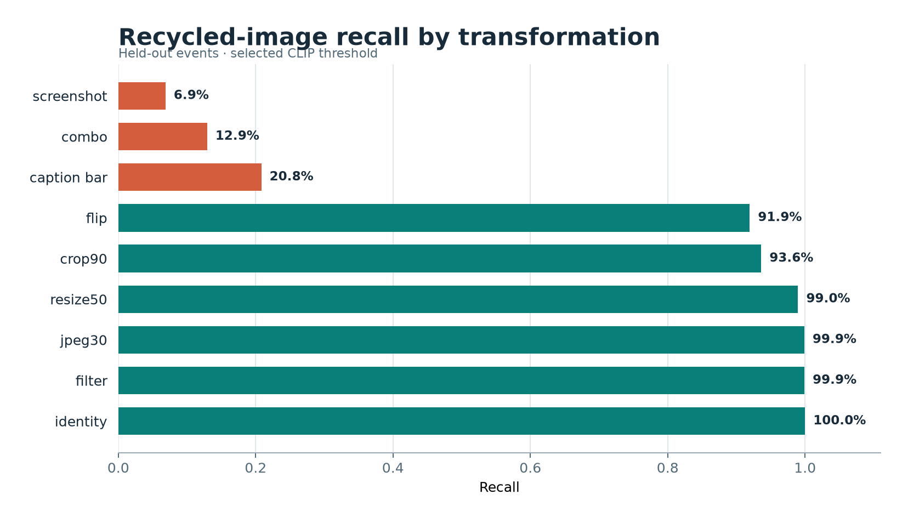

# Provenance injection benchmark

Closed-world test: each injected image's original is present in the index. This cannot measure
recall for recycled images whose originals were never indexed.

Selected CLIP threshold on tuning events: **0.925**. Graphic threshold: **0.500**.
The 432 held-out cases cover 4 events, 9 transforms,
4 injection rates and 3 seeds. Rates and seeds are macro-averaged.

### Overall

- precision: 0.606
- recall: 0.694
- f1: 0.595
- recall_at_origin: 0.622
- fpr_genuine: 0.021
- review_flag_rate: 0.068
- hard_negative_accuracy: 0.935
- mean_latency_ms: 12.918

AUPRC by transformation: identity 0.594, jpeg30 0.652, crop90 0.855, resize50 0.924, caption_bar 0.342, filter 0.986, screenshot 0.093, flip 0.902, combo 0.245

### By transform

| transform | precision | recall | f1 | recall_at_origin | fpr_genuine | review_flag_rate | hard_negative_accuracy | mean_latency_ms |
|---|---:|---:|---:|---:|---:|---:|---:|---:|
| caption_bar | 0.461 | 0.208 | 0.257 | 0.193 | 0.021 | 0.068 | 0.935 | 11.478 |
| combo | 0.376 | 0.129 | 0.171 | 0.115 | 0.021 | 0.068 | 0.935 | 11.548 |
| crop90 | 0.719 | 0.936 | 0.787 | 0.817 | 0.021 | 0.068 | 0.935 | 12.092 |
| filter | 0.729 | 0.999 | 0.817 | 0.912 | 0.021 | 0.068 | 0.935 | 12.793 |
| flip | 0.716 | 0.919 | 0.779 | 0.806 | 0.021 | 0.068 | 0.935 | 12.128 |
| identity | 0.729 | 1.000 | 0.818 | 0.888 | 0.021 | 0.068 | 0.935 | 12.125 |
| jpeg30 | 0.729 | 0.999 | 0.817 | 0.926 | 0.021 | 0.068 | 0.935 | 12.023 |
| resize50 | 0.727 | 0.990 | 0.813 | 0.877 | 0.021 | 0.068 | 0.935 | 12.192 |
| screenshot | 0.271 | 0.069 | 0.094 | 0.068 | 0.021 | 0.068 | 0.935 | 19.879 |

### By rate

| rate | precision | recall | f1 | recall_at_origin | fpr_genuine | review_flag_rate | hard_negative_accuracy | mean_latency_ms |
|---|---:|---:|---:|---:|---:|---:|---:|---:|
| 0.01 | 0.286 | 0.690 | 0.386 | 0.606 | 0.021 | 0.068 | 0.935 | 9.391 |
| 0.05 | 0.594 | 0.697 | 0.616 | 0.625 | 0.021 | 0.068 | 0.935 | 11.177 |
| 0.1 | 0.722 | 0.696 | 0.673 | 0.629 | 0.021 | 0.068 | 0.935 | 13.424 |
| 0.2 | 0.823 | 0.694 | 0.704 | 0.630 | 0.021 | 0.068 | 0.935 | 17.679 |

### By event

| event | precision | recall | f1 | recall_at_origin | fpr_genuine | review_flag_rate | hard_negative_accuracy | mean_latency_ms |
|---|---:|---:|---:|---:|---:|---:|---:|---:|
| california_wildfires | 0.530 | 0.699 | 0.557 | 0.630 | 0.027 | 0.043 | 0.983 | 12.070 |
| hurricane_maria | 0.479 | 0.694 | 0.522 | 0.621 | 0.038 | 0.063 | 0.962 | 14.321 |
| iraq_iran_earthquake | 0.773 | 0.696 | 0.681 | 0.616 | 0.005 | 0.116 | 0.793 | 13.290 |
| mexico_earthquake | 0.645 | 0.689 | 0.619 | 0.623 | 0.013 | 0.051 | 1.000 | 11.989 |

### Figures

- [Identity PR curve](../figures/prov_pr_identity.png) (AUPRC 0.594)
- [Jpeg30 PR curve](../figures/prov_pr_jpeg30.png) (AUPRC 0.652)
- [Crop90 PR curve](../figures/prov_pr_crop90.png) (AUPRC 0.855)
- [Resize50 PR curve](../figures/prov_pr_resize50.png) (AUPRC 0.924)
- [Caption Bar PR curve](../figures/prov_pr_caption_bar.png) (AUPRC 0.342)
- [Filter PR curve](../figures/prov_pr_filter.png) (AUPRC 0.986)
- [Screenshot PR curve](../figures/prov_pr_screenshot.png) (AUPRC 0.093)
- [Flip PR curve](../figures/prov_pr_flip.png) (AUPRC 0.902)
- [Combo PR curve](../figures/prov_pr_combo.png) (AUPRC 0.245)
