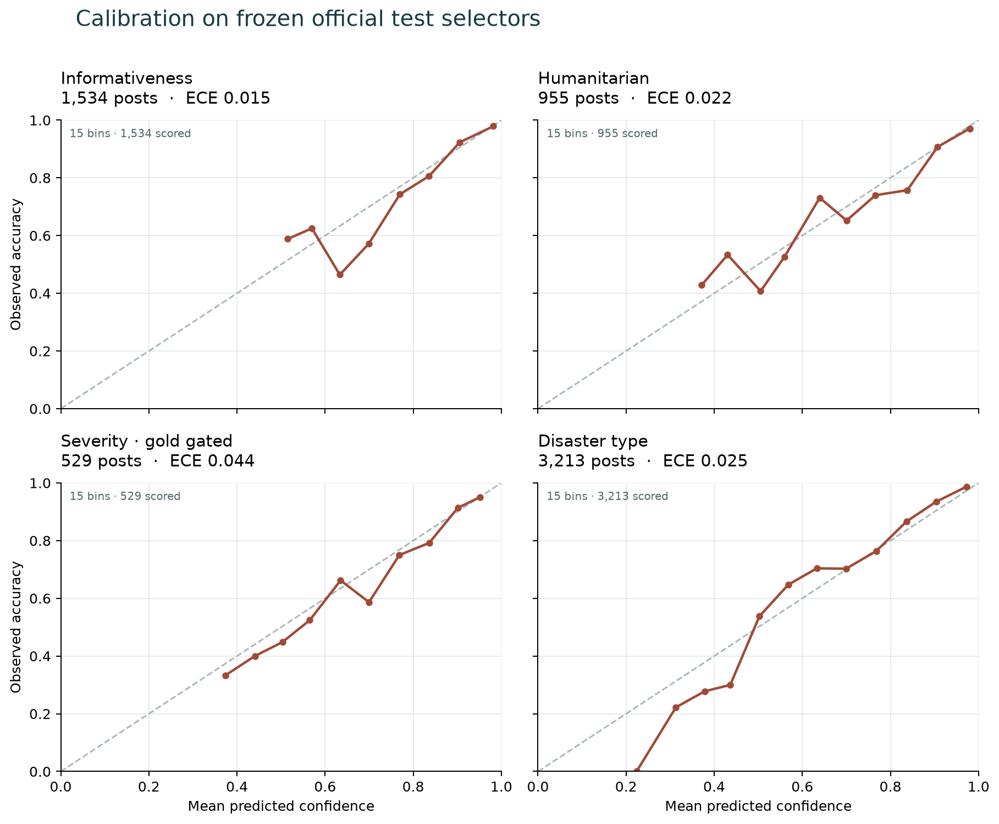
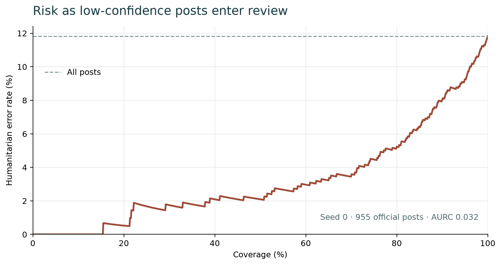

# Full classifier: frozen official test, seed 0

Run: `full-s0-20261024-062724`. Model: `full-s0`.
Bootstrap: 1,000 item resamples (95% percentile intervals).
The checkpoint, calibration, label maps, manifest, feature cache and bootstrap count were hashed
before test inference. The resulting prediction and metric hashes are recorded in
`evaluation_complete.json`. No test-driven configuration changes were made.

| Official task | Rows | Macro-F1 [95% CI] | Weighted-F1 | Accuracy | ECE | Brier |
|---|---:|---:|---:|---:|---:|---:|
| Informativeness | 1,534 | 0.919 [0.904, 0.933] | 0.929 | 0.929 | 0.015 | 0.107 |
| Humanitarian | 955 | 0.791 [0.741, 0.839] | 0.886 | 0.882 | 0.022 | 0.175 |
| Severity, gold gated | 529 | 0.590 [0.538, 0.639] | 0.678 | 0.665 | 0.044 | 0.455 |
| Severity, predicted gated | 529 | 0.582 [0.529, 0.630] | 0.671 | 0.652 | 0.044 | 0.455 |
| Severity, DMD | 1,138 | 0.445 [0.411, 0.478] | 0.324 | 0.278 | 0.047 | 0.224 |
| Disaster type, combined | 3,213 | 0.859 [0.845, 0.872] | 0.879 | 0.881 | 0.025 | 0.178 |
| Disaster type, AIDR-DT | 2,091 | 0.795 [0.774, 0.821] | 0.900 | 0.901 | 0.044 | 0.153 |
| Disaster type, DMD | 1,122 | 0.758 [0.713, 0.793] | 0.845 | 0.846 | 0.040 | 0.225 |

## Hierarchy and abstention

Hierarchy contradiction rate: **0.000**.
Humanitarian review coverage: **0.917**; selective macro-F1:
**0.880**; selective accuracy:
**0.926**; errors routed to review:
**0.425**; AURC: **0.032**.
Predicted-gated severity coverage: **0.975**.

## Per-class results and confusion matrices

### Informativeness

| Class | Support | Precision | Recall | F1 |
|---|---:|---:|---:|---:|
| not_informative | 504 | 0.906 | 0.875 | 0.890 |
| informative | 1,030 | 0.940 | 0.955 | 0.948 |

Confusion matrix (gold rows, predicted columns):

| Gold / predicted | not_informative | informative |
|---|---:|---:|
| not_informative | 441 | 63 |
| informative | 46 | 984 |

### Humanitarian

| Class | Support | Precision | Recall | F1 |
|---|---:|---:|---:|---:|
| affected_individuals | 9 | 0.292 | 0.778 | 0.424 |
| infrastructure_and_utility_damage | 81 | 0.882 | 0.926 | 0.904 |
| not_humanitarian | 504 | 0.946 | 0.869 | 0.906 |
| other_relevant_information | 235 | 0.881 | 0.881 | 0.881 |
| rescue_volunteering_or_donation_effort | 126 | 0.777 | 0.913 | 0.839 |

Confusion matrix (gold rows, predicted columns):

| Gold / predicted | affected_individuals | infrastructure_and_utility_damage | not_humanitarian | other_relevant_information | rescue_volunteering_or_donation_effort |
|---|---:|---:|---:|---:|---:|
| affected_individuals | 7 | 1 | 0 | 1 | 0 |
| infrastructure_and_utility_damage | 4 | 75 | 0 | 1 | 1 |
| not_humanitarian | 7 | 6 | 438 | 24 | 29 |
| other_relevant_information | 1 | 2 | 22 | 207 | 3 |
| rescue_volunteering_or_donation_effort | 5 | 1 | 3 | 2 | 115 |

### Severity, gold gated

| Class | Support | Precision | Recall | F1 |
|---|---:|---:|---:|---:|
| little_or_no_damage | 71 | 0.646 | 0.437 | 0.521 |
| mild_damage | 126 | 0.383 | 0.556 | 0.453 |
| severe_damage | 332 | 0.842 | 0.756 | 0.797 |

Confusion matrix (gold rows, predicted columns):

| Gold / predicted | little_or_no_damage | mild_damage | severe_damage |
|---|---:|---:|---:|
| little_or_no_damage | 31 | 36 | 4 |
| mild_damage | 13 | 70 | 43 |
| severe_damage | 4 | 77 | 251 |

### Severity, predicted gated

| Class | Support | Precision | Recall | F1 |
|---|---:|---:|---:|---:|
| little_or_no_damage | 71 | 0.683 | 0.394 | 0.500 |
| mild_damage | 126 | 0.387 | 0.556 | 0.456 |
| severe_damage | 332 | 0.840 | 0.744 | 0.789 |

Confusion matrix (gold rows, predicted columns):

| Gold / predicted | little_or_no_damage | mild_damage | severe_damage | n/a |
|---|---:|---:|---:|---:|
| little_or_no_damage | 28 | 35 | 4 | 4 |
| mild_damage | 11 | 70 | 43 | 2 |
| severe_damage | 2 | 76 | 247 | 7 |
| n/a | 0 | 0 | 0 | 0 |

### Severity, DMD

| Class | Support | Precision | Recall | F1 |
|---|---:|---:|---:|---:|
| little_or_no_damage | 778 | 0.766 | 0.105 | 0.185 |
| mild_damage | 132 | 0.438 | 0.348 | 0.388 |
| severe_damage | 228 | 0.707 | 0.825 | 0.761 |

Confusion matrix (gold rows, predicted columns):

| Gold / predicted | little_or_no_damage | mild_damage | severe_damage | n/a |
|---|---:|---:|---:|---:|
| little_or_no_damage | 82 | 34 | 20 | 642 |
| mild_damage | 19 | 46 | 58 | 9 |
| severe_damage | 6 | 25 | 188 | 9 |
| n/a | 0 | 0 | 0 | 0 |

### Disaster type, combined

| Class | Support | Precision | Recall | F1 |
|---|---:|---:|---:|---:|
| earthquake | 411 | 0.821 | 0.927 | 0.871 |
| fire | 285 | 0.934 | 0.947 | 0.941 |
| flood | 603 | 0.904 | 0.904 | 0.904 |
| hurricane | 352 | 0.821 | 0.767 | 0.793 |
| landslide | 268 | 0.907 | 0.914 | 0.911 |
| not_disaster | 990 | 0.927 | 0.951 | 0.939 |
| other_disaster | 304 | 0.741 | 0.592 | 0.658 |

Confusion matrix (gold rows, predicted columns):

| Gold / predicted | earthquake | fire | flood | hurricane | landslide | not_disaster | other_disaster |
|---|---:|---:|---:|---:|---:|---:|---:|
| earthquake | 381 | 0 | 0 | 9 | 4 | 2 | 15 |
| fire | 4 | 270 | 0 | 2 | 1 | 3 | 5 |
| flood | 2 | 1 | 545 | 19 | 8 | 23 | 5 |
| hurricane | 5 | 3 | 35 | 270 | 6 | 9 | 24 |
| landslide | 9 | 2 | 4 | 3 | 245 | 4 | 1 |
| not_disaster | 16 | 0 | 11 | 8 | 1 | 941 | 13 |
| other_disaster | 47 | 13 | 8 | 18 | 5 | 33 | 180 |

### Disaster type, AIDR-DT

| Class | Support | Precision | Recall | F1 |
|---|---:|---:|---:|---:|
| earthquake | 376 | 0.897 | 0.952 | 0.924 |
| fire | 214 | 0.958 | 0.958 | 0.958 |
| flood | 533 | 0.911 | 0.901 | 0.906 |
| hurricane | 279 | 0.853 | 0.810 | 0.831 |
| landslide | 257 | 0.922 | 0.914 | 0.918 |
| not_disaster | 415 | 0.908 | 0.908 | 0.908 |
| other_disaster | 17 | 0.125 | 0.118 | 0.121 |

Confusion matrix (gold rows, predicted columns):

| Gold / predicted | earthquake | fire | flood | hurricane | landslide | not_disaster | other_disaster |
|---|---:|---:|---:|---:|---:|---:|---:|
| earthquake | 358 | 0 | 0 | 8 | 4 | 2 | 4 |
| fire | 4 | 205 | 0 | 2 | 1 | 1 | 1 |
| flood | 2 | 1 | 480 | 17 | 8 | 22 | 3 |
| hurricane | 4 | 3 | 32 | 226 | 5 | 7 | 2 |
| landslide | 9 | 2 | 4 | 3 | 235 | 3 | 1 |
| not_disaster | 16 | 0 | 10 | 8 | 1 | 377 | 3 |
| other_disaster | 6 | 3 | 1 | 1 | 1 | 3 | 2 |

### Disaster type, DMD

| Class | Support | Precision | Recall | F1 |
|---|---:|---:|---:|---:|
| earthquake | 35 | 0.354 | 0.657 | 0.460 |
| fire | 71 | 0.867 | 0.915 | 0.890 |
| flood | 70 | 0.855 | 0.929 | 0.890 |
| hurricane | 73 | 0.688 | 0.603 | 0.642 |
| landslide | 11 | 0.667 | 0.909 | 0.769 |
| not_disaster | 575 | 0.940 | 0.981 | 0.960 |
| other_disaster | 287 | 0.784 | 0.620 | 0.693 |

Confusion matrix (gold rows, predicted columns):

| Gold / predicted | earthquake | fire | flood | hurricane | landslide | not_disaster | other_disaster |
|---|---:|---:|---:|---:|---:|---:|---:|
| earthquake | 23 | 0 | 0 | 1 | 0 | 0 | 11 |
| fire | 0 | 65 | 0 | 0 | 0 | 2 | 4 |
| flood | 0 | 0 | 65 | 2 | 0 | 1 | 2 |
| hurricane | 1 | 0 | 3 | 44 | 1 | 2 | 22 |
| landslide | 0 | 0 | 0 | 0 | 10 | 1 | 0 |
| not_disaster | 0 | 0 | 1 | 0 | 0 | 564 | 10 |
| other_disaster | 41 | 10 | 7 | 17 | 4 | 30 | 178 |

## Scope

This is one trained seed on the fixed official selectors. It is an E1/E6 result,
but the planned three-seed summary, B1–B4/B6 baselines, ablations, LOEO and HumAID
runs are still outstanding. Development-set checkpoint selection and calibration
are documented in `classifier_seed0_dev.md`; B5 is reported separately in
`baselines_clip_zeroshot.md`. Do not use this report as a complete E1–E6 table.

## Figures





## Reproduce

```bash
sakshi-model evaluate --run runs/classifier/full-s0-20261024-062724
sakshi-model report --run runs/classifier/full-s0-20261024-062724
```
