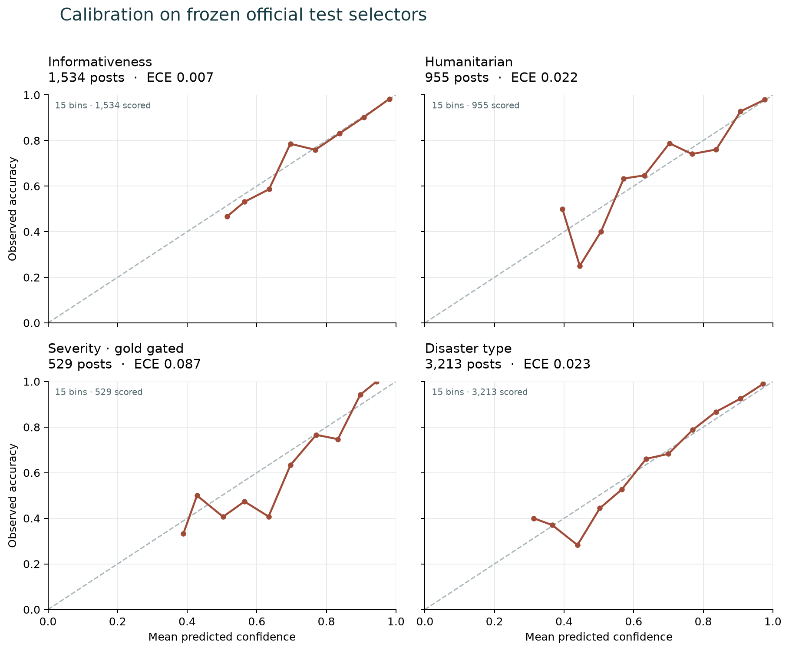
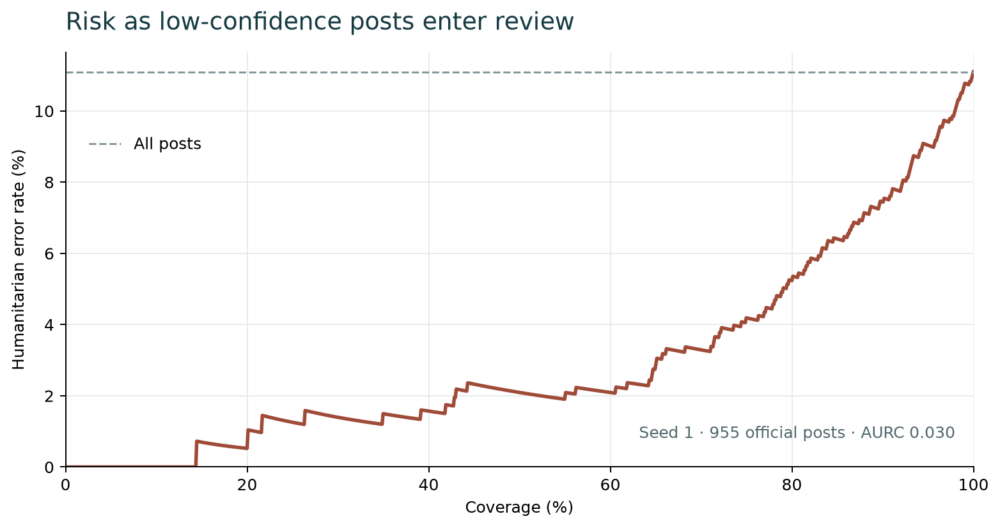

# Full classifier: frozen official test, seed 1

Run: `full-s1-20261025-062842`. Model: `full-s1`.
Bootstrap: 1,000 item resamples (95% percentile intervals).
The checkpoint, calibration, label maps, manifest, feature cache and bootstrap count were hashed
before test inference. The resulting prediction and metric hashes are recorded in
`evaluation_complete.json`. No test-driven configuration changes were made.

| Official task | Rows | Macro-F1 [95% CI] | Weighted-F1 | Accuracy | ECE | Brier |
|---|---:|---:|---:|---:|---:|---:|
| Informativeness | 1,534 | 0.920 [0.905, 0.935] | 0.930 | 0.930 | 0.007 | 0.105 |
| Humanitarian | 955 | 0.835 [0.774, 0.882] | 0.890 | 0.889 | 0.022 | 0.167 |
| Severity, gold gated | 529 | 0.529 [0.477, 0.582] | 0.639 | 0.635 | 0.087 | 0.466 |
| Severity, predicted gated | 529 | 0.502 [0.450, 0.555] | 0.623 | 0.614 | 0.087 | 0.466 |
| Severity, DMD | 1,138 | 0.450 [0.416, 0.480] | 0.307 | 0.261 | 0.062 | 0.254 |
| Disaster type, combined | 3,213 | 0.851 [0.836, 0.863] | 0.871 | 0.874 | 0.023 | 0.181 |
| Disaster type, AIDR-DT | 2,091 | 0.791 [0.771, 0.814] | 0.896 | 0.895 | 0.038 | 0.152 |
| Disaster type, DMD | 1,122 | 0.727 [0.683, 0.765] | 0.832 | 0.833 | 0.036 | 0.236 |

## Hierarchy and abstention

Hierarchy contradiction rate: **0.000**.
Humanitarian review coverage: **0.908**; selective macro-F1:
**0.888**; selective accuracy:
**0.925**; errors routed to review:
**0.387**; AURC: **0.030**.
Predicted-gated severity coverage: **0.974**.

## Per-class results and confusion matrices

### Informativeness

| Class | Support | Precision | Recall | F1 |
|---|---:|---:|---:|---:|
| not_informative | 504 | 0.913 | 0.871 | 0.891 |
| informative | 1,030 | 0.938 | 0.959 | 0.949 |

Confusion matrix (gold rows, predicted columns):

| Gold / predicted | not_informative | informative |
|---|---:|---:|
| not_informative | 439 | 65 |
| informative | 42 | 988 |

### Humanitarian

| Class | Support | Precision | Recall | F1 |
|---|---:|---:|---:|---:|
| affected_individuals | 9 | 0.500 | 0.778 | 0.609 |
| infrastructure_and_utility_damage | 81 | 0.865 | 0.951 | 0.906 |
| not_humanitarian | 504 | 0.948 | 0.867 | 0.906 |
| other_relevant_information | 235 | 0.822 | 0.906 | 0.862 |
| rescue_volunteering_or_donation_effort | 126 | 0.871 | 0.913 | 0.891 |

Confusion matrix (gold rows, predicted columns):

| Gold / predicted | affected_individuals | infrastructure_and_utility_damage | not_humanitarian | other_relevant_information | rescue_volunteering_or_donation_effort |
|---|---:|---:|---:|---:|---:|
| affected_individuals | 7 | 0 | 0 | 1 | 1 |
| infrastructure_and_utility_damage | 1 | 77 | 0 | 1 | 2 |
| not_humanitarian | 4 | 8 | 437 | 41 | 14 |
| other_relevant_information | 0 | 3 | 19 | 213 | 0 |
| rescue_volunteering_or_donation_effort | 2 | 1 | 5 | 3 | 115 |

### Severity, gold gated

| Class | Support | Precision | Recall | F1 |
|---|---:|---:|---:|---:|
| little_or_no_damage | 71 | 0.656 | 0.296 | 0.408 |
| mild_damage | 126 | 0.345 | 0.476 | 0.400 |
| severe_damage | 332 | 0.789 | 0.768 | 0.779 |

Confusion matrix (gold rows, predicted columns):

| Gold / predicted | little_or_no_damage | mild_damage | severe_damage |
|---|---:|---:|---:|
| little_or_no_damage | 21 | 40 | 10 |
| mild_damage | 8 | 60 | 58 |
| severe_damage | 3 | 74 | 255 |

### Severity, predicted gated

| Class | Support | Precision | Recall | F1 |
|---|---:|---:|---:|---:|
| little_or_no_damage | 71 | 0.630 | 0.239 | 0.347 |
| mild_damage | 126 | 0.337 | 0.452 | 0.386 |
| severe_damage | 332 | 0.787 | 0.756 | 0.771 |

Confusion matrix (gold rows, predicted columns):

| Gold / predicted | little_or_no_damage | mild_damage | severe_damage | n/a |
|---|---:|---:|---:|---:|
| little_or_no_damage | 17 | 39 | 10 | 5 |
| mild_damage | 7 | 57 | 58 | 4 |
| severe_damage | 3 | 73 | 251 | 5 |
| n/a | 0 | 0 | 0 | 0 |

### Severity, DMD

| Class | Support | Precision | Recall | F1 |
|---|---:|---:|---:|---:|
| little_or_no_damage | 778 | 0.812 | 0.089 | 0.160 |
| mild_damage | 132 | 0.406 | 0.621 | 0.491 |
| severe_damage | 228 | 0.772 | 0.640 | 0.700 |

Confusion matrix (gold rows, predicted columns):

| Gold / predicted | little_or_no_damage | mild_damage | severe_damage | n/a |
|---|---:|---:|---:|---:|
| little_or_no_damage | 69 | 54 | 12 | 643 |
| mild_damage | 10 | 82 | 31 | 9 |
| severe_damage | 6 | 66 | 146 | 10 |
| n/a | 0 | 0 | 0 | 0 |

### Disaster type, combined

| Class | Support | Precision | Recall | F1 |
|---|---:|---:|---:|---:|
| earthquake | 411 | 0.807 | 0.946 | 0.871 |
| fire | 285 | 0.923 | 0.965 | 0.943 |
| flood | 603 | 0.883 | 0.892 | 0.888 |
| hurricane | 352 | 0.810 | 0.761 | 0.785 |
| landslide | 268 | 0.900 | 0.907 | 0.903 |
| not_disaster | 990 | 0.934 | 0.932 | 0.933 |
| other_disaster | 304 | 0.728 | 0.562 | 0.635 |

Confusion matrix (gold rows, predicted columns):

| Gold / predicted | earthquake | fire | flood | hurricane | landslide | not_disaster | other_disaster |
|---|---:|---:|---:|---:|---:|---:|---:|
| earthquake | 389 | 0 | 0 | 6 | 1 | 7 | 8 |
| fire | 4 | 275 | 0 | 1 | 1 | 1 | 3 |
| flood | 4 | 1 | 538 | 34 | 5 | 17 | 4 |
| hurricane | 8 | 2 | 30 | 268 | 7 | 8 | 29 |
| landslide | 13 | 2 | 6 | 1 | 243 | 1 | 2 |
| not_disaster | 15 | 2 | 20 | 9 | 3 | 923 | 18 |
| other_disaster | 49 | 16 | 15 | 12 | 10 | 31 | 171 |

### Disaster type, AIDR-DT

| Class | Support | Precision | Recall | F1 |
|---|---:|---:|---:|---:|
| earthquake | 376 | 0.890 | 0.965 | 0.926 |
| fire | 214 | 0.959 | 0.977 | 0.968 |
| flood | 533 | 0.903 | 0.889 | 0.896 |
| hurricane | 279 | 0.833 | 0.821 | 0.827 |
| landslide | 257 | 0.935 | 0.903 | 0.919 |
| not_disaster | 415 | 0.917 | 0.875 | 0.895 |
| other_disaster | 17 | 0.095 | 0.118 | 0.105 |

Confusion matrix (gold rows, predicted columns):

| Gold / predicted | earthquake | fire | flood | hurricane | landslide | not_disaster | other_disaster |
|---|---:|---:|---:|---:|---:|---:|---:|
| earthquake | 363 | 0 | 0 | 4 | 1 | 5 | 3 |
| fire | 3 | 209 | 0 | 1 | 1 | 0 | 0 |
| flood | 4 | 1 | 474 | 30 | 5 | 16 | 3 |
| hurricane | 6 | 2 | 27 | 229 | 6 | 6 | 3 |
| landslide | 13 | 2 | 6 | 1 | 232 | 1 | 2 |
| not_disaster | 15 | 1 | 17 | 9 | 2 | 363 | 8 |
| other_disaster | 4 | 3 | 1 | 1 | 1 | 5 | 2 |

### Disaster type, DMD

| Class | Support | Precision | Recall | F1 |
|---|---:|---:|---:|---:|
| earthquake | 35 | 0.351 | 0.743 | 0.477 |
| fire | 71 | 0.825 | 0.930 | 0.874 |
| flood | 70 | 0.762 | 0.914 | 0.831 |
| hurricane | 73 | 0.696 | 0.534 | 0.605 |
| landslide | 11 | 0.500 | 1.000 | 0.667 |
| not_disaster | 575 | 0.946 | 0.974 | 0.960 |
| other_disaster | 287 | 0.790 | 0.589 | 0.675 |

Confusion matrix (gold rows, predicted columns):

| Gold / predicted | earthquake | fire | flood | hurricane | landslide | not_disaster | other_disaster |
|---|---:|---:|---:|---:|---:|---:|---:|
| earthquake | 26 | 0 | 0 | 2 | 0 | 2 | 5 |
| fire | 1 | 66 | 0 | 0 | 0 | 1 | 3 |
| flood | 0 | 0 | 64 | 4 | 0 | 1 | 1 |
| hurricane | 2 | 0 | 3 | 39 | 1 | 2 | 26 |
| landslide | 0 | 0 | 0 | 0 | 11 | 0 | 0 |
| not_disaster | 0 | 1 | 3 | 0 | 1 | 560 | 10 |
| other_disaster | 45 | 13 | 14 | 11 | 9 | 26 | 169 |

## Scope

This is one trained seed on the fixed official selectors. It is an E1/E6 result,
but the planned three-seed summary, B1–B4/B6 baselines, ablations, LOEO and HumAID
runs are still outstanding. Development-set checkpoint selection and calibration
are recorded in this run's `metrics_dev.json`; B5 is reported separately in
`baselines_clip_zeroshot.md`. Do not use this report as a complete E1–E6 table.

## Figures





## Reproduce

```bash
sakshi-model evaluate --run runs/classifier/full-s1-20261025-062842
sakshi-model report --run runs/classifier/full-s1-20261025-062842
```
