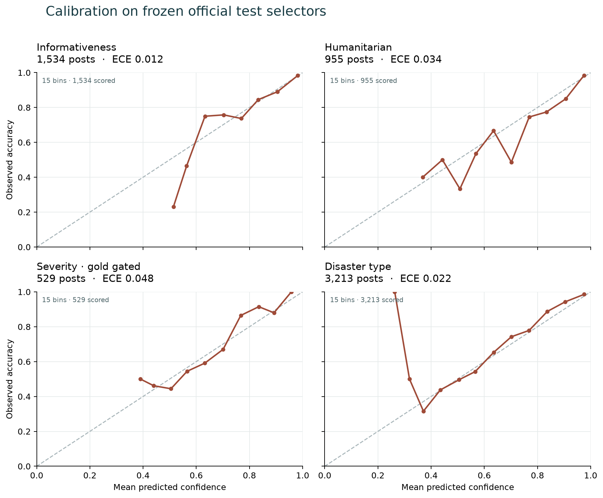
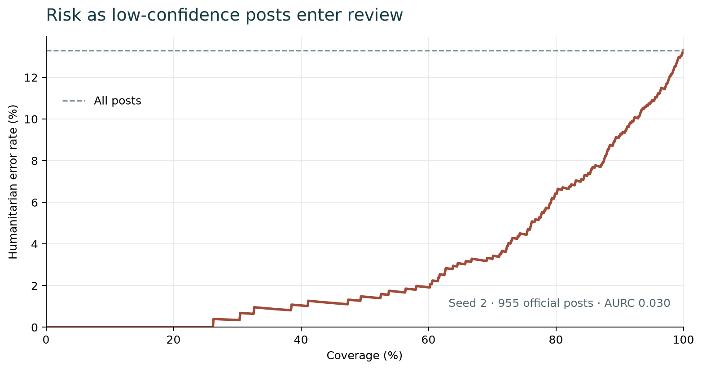

# Full classifier: frozen official test, seed 2

Run: `full-s2-20261025-143538`. Model: `full-s2`.
Bootstrap: 1,000 item resamples (95% percentile intervals).
The checkpoint, calibration, label maps, manifest, feature cache and bootstrap count were hashed
before test inference. The resulting prediction and metric hashes are recorded in
`evaluation_complete.json`. No test-driven configuration changes were made.

| Official task | Rows | Macro-F1 [95% CI] | Weighted-F1 | Accuracy | ECE | Brier |
|---|---:|---:|---:|---:|---:|---:|
| Informativeness | 1,534 | 0.919 [0.903, 0.933] | 0.930 | 0.931 | 0.012 | 0.104 |
| Humanitarian | 955 | 0.841 [0.770, 0.890] | 0.868 | 0.867 | 0.034 | 0.182 |
| Severity, gold gated | 529 | 0.546 [0.492, 0.600] | 0.658 | 0.652 | 0.048 | 0.457 |
| Severity, predicted gated | 529 | 0.531 [0.477, 0.585] | 0.649 | 0.639 | 0.048 | 0.457 |
| Severity, DMD | 1,138 | 0.433 [0.396, 0.464] | 0.308 | 0.261 | 0.039 | 0.225 |
| Disaster type, combined | 3,213 | 0.856 [0.842, 0.869] | 0.876 | 0.878 | 0.022 | 0.184 |
| Disaster type, AIDR-DT | 2,091 | 0.784 [0.768, 0.801] | 0.897 | 0.892 | 0.042 | 0.171 |
| Disaster type, DMD | 1,122 | 0.764 [0.723, 0.799] | 0.844 | 0.850 | 0.023 | 0.206 |

## Hierarchy and abstention

Hierarchy contradiction rate: **0.000**.
Humanitarian review coverage: **0.913**; selective macro-F1:
**0.904**; selective accuracy:
**0.909**; errors routed to review:
**0.378**; AURC: **0.030**.
Predicted-gated severity coverage: **0.977**.

## Per-class results and confusion matrices

### Informativeness

| Class | Support | Precision | Recall | F1 |
|---|---:|---:|---:|---:|
| not_informative | 504 | 0.956 | 0.827 | 0.887 |
| informative | 1,030 | 0.921 | 0.982 | 0.950 |

Confusion matrix (gold rows, predicted columns):

| Gold / predicted | not_informative | informative |
|---|---:|---:|
| not_informative | 417 | 87 |
| informative | 19 | 1011 |

### Humanitarian

| Class | Support | Precision | Recall | F1 |
|---|---:|---:|---:|---:|
| affected_individuals | 9 | 0.750 | 0.667 | 0.706 |
| infrastructure_and_utility_damage | 81 | 0.898 | 0.975 | 0.935 |
| not_humanitarian | 504 | 0.969 | 0.796 | 0.874 |
| other_relevant_information | 235 | 0.784 | 0.945 | 0.857 |
| rescue_volunteering_or_donation_effort | 126 | 0.741 | 0.952 | 0.833 |

Confusion matrix (gold rows, predicted columns):

| Gold / predicted | affected_individuals | infrastructure_and_utility_damage | not_humanitarian | other_relevant_information | rescue_volunteering_or_donation_effort |
|---|---:|---:|---:|---:|---:|
| affected_individuals | 6 | 0 | 0 | 1 | 2 |
| infrastructure_and_utility_damage | 0 | 79 | 1 | 0 | 1 |
| not_humanitarian | 2 | 8 | 401 | 57 | 36 |
| other_relevant_information | 0 | 1 | 9 | 222 | 3 |
| rescue_volunteering_or_donation_effort | 0 | 0 | 3 | 3 | 120 |

### Severity, gold gated

| Class | Support | Precision | Recall | F1 |
|---|---:|---:|---:|---:|
| little_or_no_damage | 71 | 0.667 | 0.282 | 0.396 |
| mild_damage | 126 | 0.374 | 0.563 | 0.449 |
| severe_damage | 332 | 0.822 | 0.765 | 0.793 |

Confusion matrix (gold rows, predicted columns):

| Gold / predicted | little_or_no_damage | mild_damage | severe_damage |
|---|---:|---:|---:|
| little_or_no_damage | 20 | 43 | 8 |
| mild_damage | 8 | 71 | 47 |
| severe_damage | 2 | 76 | 254 |

### Severity, predicted gated

| Class | Support | Precision | Recall | F1 |
|---|---:|---:|---:|---:|
| little_or_no_damage | 71 | 0.739 | 0.239 | 0.362 |
| mild_damage | 126 | 0.372 | 0.556 | 0.446 |
| severe_damage | 332 | 0.820 | 0.756 | 0.787 |

Confusion matrix (gold rows, predicted columns):

| Gold / predicted | little_or_no_damage | mild_damage | severe_damage | n/a |
|---|---:|---:|---:|---:|
| little_or_no_damage | 17 | 43 | 8 | 3 |
| mild_damage | 4 | 70 | 47 | 5 |
| severe_damage | 2 | 75 | 251 | 4 |
| n/a | 0 | 0 | 0 | 0 |

### Severity, DMD

| Class | Support | Precision | Recall | F1 |
|---|---:|---:|---:|---:|
| little_or_no_damage | 778 | 0.753 | 0.094 | 0.167 |
| mild_damage | 132 | 0.397 | 0.379 | 0.388 |
| severe_damage | 228 | 0.725 | 0.763 | 0.744 |

Confusion matrix (gold rows, predicted columns):

| Gold / predicted | little_or_no_damage | mild_damage | severe_damage | n/a |
|---|---:|---:|---:|---:|
| little_or_no_damage | 73 | 37 | 13 | 655 |
| mild_damage | 17 | 50 | 53 | 12 |
| severe_damage | 7 | 39 | 174 | 8 |
| n/a | 0 | 0 | 0 | 0 |

### Disaster type, combined

| Class | Support | Precision | Recall | F1 |
|---|---:|---:|---:|---:|
| earthquake | 411 | 0.897 | 0.873 | 0.885 |
| fire | 285 | 0.945 | 0.965 | 0.955 |
| flood | 603 | 0.853 | 0.942 | 0.895 |
| hurricane | 352 | 0.828 | 0.739 | 0.781 |
| landslide | 268 | 0.945 | 0.828 | 0.883 |
| not_disaster | 990 | 0.929 | 0.949 | 0.939 |
| other_disaster | 304 | 0.664 | 0.645 | 0.654 |

Confusion matrix (gold rows, predicted columns):

| Gold / predicted | earthquake | fire | flood | hurricane | landslide | not_disaster | other_disaster |
|---|---:|---:|---:|---:|---:|---:|---:|
| earthquake | 359 | 1 | 0 | 6 | 4 | 10 | 31 |
| fire | 1 | 275 | 0 | 2 | 0 | 0 | 7 |
| flood | 0 | 0 | 568 | 18 | 3 | 11 | 3 |
| hurricane | 4 | 3 | 40 | 260 | 3 | 7 | 35 |
| landslide | 11 | 2 | 14 | 5 | 222 | 3 | 11 |
| not_disaster | 6 | 1 | 23 | 7 | 1 | 940 | 12 |
| other_disaster | 19 | 9 | 21 | 16 | 2 | 41 | 196 |

### Disaster type, AIDR-DT

| Class | Support | Precision | Recall | F1 |
|---|---:|---:|---:|---:|
| earthquake | 376 | 0.935 | 0.912 | 0.923 |
| fire | 214 | 0.963 | 0.967 | 0.965 |
| flood | 533 | 0.879 | 0.942 | 0.909 |
| hurricane | 279 | 0.856 | 0.806 | 0.830 |
| landslide | 257 | 0.946 | 0.825 | 0.881 |
| not_disaster | 415 | 0.921 | 0.904 | 0.912 |
| other_disaster | 17 | 0.045 | 0.118 | 0.066 |

Confusion matrix (gold rows, predicted columns):

| Gold / predicted | earthquake | fire | flood | hurricane | landslide | not_disaster | other_disaster |
|---|---:|---:|---:|---:|---:|---:|---:|
| earthquake | 343 | 0 | 0 | 6 | 4 | 7 | 16 |
| fire | 1 | 207 | 0 | 2 | 0 | 0 | 4 |
| flood | 0 | 0 | 502 | 16 | 3 | 10 | 2 |
| hurricane | 4 | 3 | 34 | 225 | 3 | 5 | 5 |
| landslide | 11 | 2 | 14 | 5 | 212 | 3 | 10 |
| not_disaster | 6 | 1 | 20 | 7 | 1 | 375 | 5 |
| other_disaster | 2 | 2 | 1 | 2 | 1 | 7 | 2 |

### Disaster type, DMD

| Class | Support | Precision | Recall | F1 |
|---|---:|---:|---:|---:|
| earthquake | 35 | 0.485 | 0.457 | 0.471 |
| fire | 71 | 0.895 | 0.958 | 0.925 |
| flood | 70 | 0.695 | 0.943 | 0.800 |
| hurricane | 73 | 0.686 | 0.479 | 0.565 |
| landslide | 11 | 0.909 | 0.909 | 0.909 |
| not_disaster | 575 | 0.934 | 0.983 | 0.958 |
| other_disaster | 287 | 0.773 | 0.676 | 0.721 |

Confusion matrix (gold rows, predicted columns):

| Gold / predicted | earthquake | fire | flood | hurricane | landslide | not_disaster | other_disaster |
|---|---:|---:|---:|---:|---:|---:|---:|
| earthquake | 16 | 1 | 0 | 0 | 0 | 3 | 15 |
| fire | 0 | 68 | 0 | 0 | 0 | 0 | 3 |
| flood | 0 | 0 | 66 | 2 | 0 | 1 | 1 |
| hurricane | 0 | 0 | 6 | 35 | 0 | 2 | 30 |
| landslide | 0 | 0 | 0 | 0 | 10 | 0 | 1 |
| not_disaster | 0 | 0 | 3 | 0 | 0 | 565 | 7 |
| other_disaster | 17 | 7 | 20 | 14 | 1 | 34 | 194 |

## Scope

This is one trained seed on the fixed official selectors. It is an E1/E6 result,
but the planned three-seed summary, B1–B4/B6 baselines, ablations, LOEO and HumAID
runs are still outstanding. Development-set checkpoint selection and calibration
are recorded in this run's `metrics_dev.json`; B5 is reported separately in
`baselines_clip_zeroshot.md`. Do not use this report as a complete E1–E6 table.

## Figures





## Reproduce

```bash
sakshi-model evaluate --run runs/classifier/full-s2-20261025-143538
sakshi-model report --run runs/classifier/full-s2-20261025-143538
```
